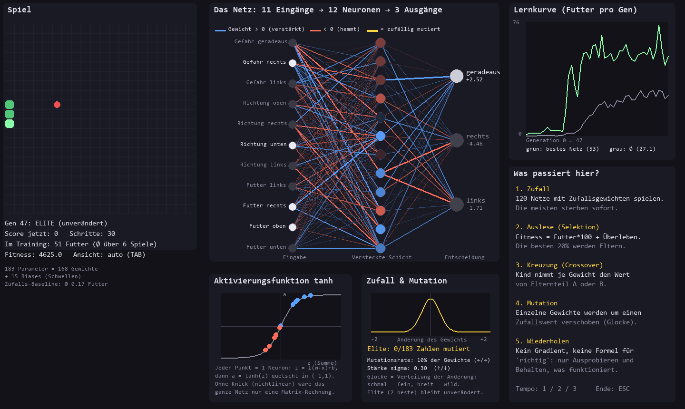
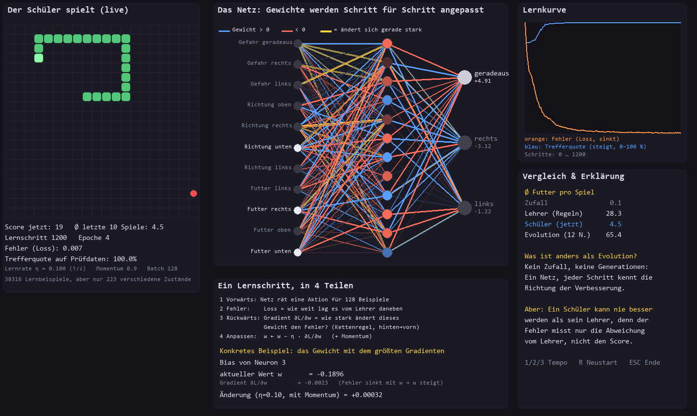
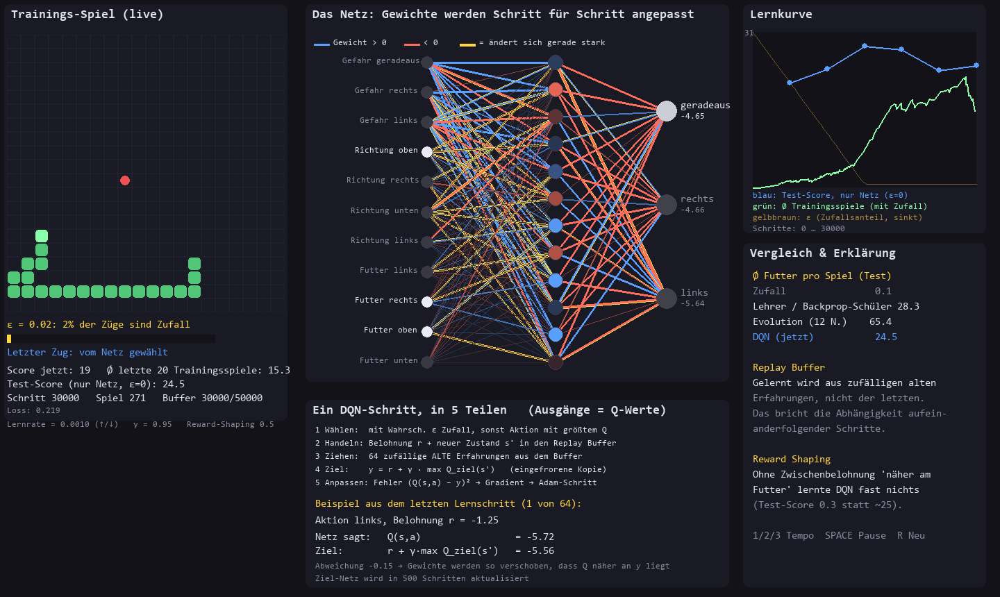
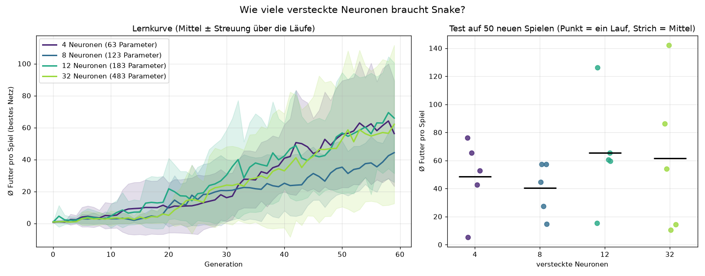

# ML-Snake

Kleines Lernprojekt: Dieselbe Snake-Umgebung wird mit drei verschiedenen Lernverfahren gespielt. Das Ziel war nicht die beste Snake-KI, sondern zu verstehen, wie sich die Verfahren unterscheiden. Jedes Verfahren hat ein Live-Fenster, in dem man dem Netz beim Lernen zusieht: Neuronen, Gewichte, Aktivierungsfunktion und die Größe jeder Anpassung sind sichtbar.

Ein einzelnes neuronales Netz mit 11 Eingängen, 12 versteckten Neuronen (tanh) und 3 Ausgängen wird in allen Verfahren verwendet. Nur die Art, wie die Gewichte entstehen, ändert sich.

| Verfahren | Datei | Wie die Gewichte entstehen |
|---|---|---|
| Neuroevolution | `evolve.py` | 120 Netze spielen, die besten werden gekreuzt und zufällig mutiert |
| Backpropagation (Imitation Learning) | `imitation.py`, `backprop_live.py` | Ein Netz lernt per Gradientenabstieg, eine Regel-KI nachzuahmen |
| Deep Q-Learning (DQN) | `dqn.py`, `dqn_live.py` | Ein Netz schätzt den Wert jeder Aktion und lernt aus Belohnungen |





## Die Umgebung

`env.py` ist ein Snake auf einem 20×20-Feld, getrennt von der Darstellung (`viewer.py`). Die Schnittstelle ähnelt Gym: `reset()` und `step(aktion)` liefern Zustand, Belohnung und ein Ende-Signal.

Das Netz sieht 11 Merkmale: Gefahr geradeaus, rechts und links, die Fahrtrichtung (4 Werte) und die Lage des Futters relativ zum Kopf (4 Werte). Die drei Aktionen sind geradeaus, rechts und links, jeweils bezogen auf die Fahrtrichtung. Futter gibt +10, der Tod −10. Ein Zeitlimit beendet Spiele, in denen die Schlange zu lange nichts frisst.

## Ergebnisse

Gemessen als durchschnittliche Anzahl Futter pro Spiel auf 50 Testspielen, die im Training nie vorkamen.

| Verfahren | Ø Futter | Belastbarkeit |
|---|---|---|
| Zufall | 0,1 | gut |
| Regel-Lehrer | 28,3 | gut |
| Backprop-Schüler (Imitation) | 28,3 | gut, identisch zum Lehrer |
| DQN ohne Reward Shaping | 0,3 | 1 Lauf |
| DQN mit Reward Shaping | 25 bis 28 | 1 Lauf pro Variante, Schwankung etwa ±5 |
| Evolution, 12 Neuronen | 65 ± 35 | 5 Läufe, sehr große Streuung |

Bei der Evolution reichte die Spanne einzelner Läufe von 15 bis 126 Futter. Der Mittelwert liegt damit höher als bei den anderen Verfahren, ist aber nur mit Vorsicht zu lesen.

### Wie viele versteckte Neuronen?

Die 12 Neuronen waren zunächst eine Schätzung ohne Begründung. Deshalb gibt es `compare.py`: 4, 8, 12 und 32 Neuronen, je 5 unabhängige Evolutionsläufe über 60 Generationen, am Ende getestet auf 50 neuen Spielen.

| Neuronen | Parameter | Test Ø ± Std |
|---|---|---|
| 4 | 63 | 48,5 ± 24,3 |
| 8 | 123 | 40,3 ± 16,8 |
| 12 | 183 | 65,4 ± 35,3 |
| 32 | 483 | 61,5 ± 48,9 |

Die Streuung zwischen Läufen derselben Größe ist größer als der Abstand zwischen den Größen. Ein Unterschied durch die Netzgröße lässt sich mit 5 Läufen nicht belegen. Der Plot liegt in `results/hidden_size.png`.



## Was ich gelernt habe

**Evolution und Gradientenabstieg lösen dasselbe Problem auf verschiedene Weise.** Bei der Evolution probieren viele Netze zufällig aus, und die guten überleben. Es gibt keine Information darüber, welches Gewicht woran schuld war. Bei der Backpropagation liefert die Kettenregel für jedes Gewicht die Richtung, in die es den Fehler verringert. Das ist sehr viel direkter, setzt aber einen ableitbaren Fehler voraus.

**Ein einzelner Lauf sagt fast nichts.** Zwei Evolutionsläufe mit identischen Einstellungen endeten bei 5,4 und 76,2 Futter. Wer zwei Verfahren oder zwei Einstellungen vergleicht, braucht mehrere Läufe und muss die Streuung mit angeben. Ohne das vergleicht man Zufall mit Zufall.

**Trainings- und Testwerte trennen.** Der Testscore der Evolution und von DQN stammt aus Spielen mit eigenen Seeds. Bei DQN zeigt der Trainingsscore außerdem etwas anderes als die Strategie: Solange ε groß ist, würfelt das Netz viele Züge, und der Score im Training liegt weit unter dem des fertigen Netzes. Für die Beurteilung zählt die Auswertung ohne Zufall.

**Eine Prüfmenge muss wirklich ungesehen sein.** Der Imitations-Schüler erreichte 100 % Trefferquote auf „ungesehenen" Daten. Das Feature-Set hat aber nur 223 verschiedene Zustände bei 48 000 Beispielen. Die Prüfdaten enthielten also fast nur Zustände, die schon im Training vorkamen. Das Netz hat im Kern eine Tabelle gelernt. Eine saubere Trennung hätte die Zustände aufteilen müssen, nicht die Beispiele.

**Selbstgebaute Backpropagation braucht einen Gradienten-Check.** Fehler in Vorzeichen oder Transposition fallen nicht auf, weil das Netz trotzdem irgendwie lernt. Der Check verschiebt einzelne Parameter um ±h und vergleicht die gemessene Fehleränderung mit dem berechneten Gradienten. Hier lag der relative Fehler bei etwa 8·10⁻¹⁰.

**Ein Schüler wird nicht besser als sein Lehrer.** Der Imitations-Schüler erreicht exakt 28,3, den Score des Lehrers. Der Fehler misst nur die Abweichung vom Lehrer und nie den Score. Die Evolution optimiert den Score direkt und liegt deutlich darüber.

**Spärliche Belohnung ist das eigentliche Problem bei DQN.** Ohne Zwischenbelohnung kam DQN auf 0,3 Futter. Ein zufällig fahrendes Netz frisst im Schnitt nur etwa 0,17 Futter pro Spiel, es gibt also kaum positive Beispiele. Mit einem Hilfssignal für die Nähe zum Futter stieg der Wert auf etwa 25 bis 28.

**Reward Shaping, das die Aufgabe nicht verändert.** Ein naher Bonus kann ausgenutzt werden: Das Netz pendelt zum Futter hin und her und sammelt Bonus, ohne zu fressen. Die potentialbasierte Form `r' = r + γ·Φ(s') − Φ(s)` (Ng et al., 1999) lässt die beste Strategie unverändert. Als Potential Φ dient die Nähe zum Futter, im Endzustand ist Φ = 0.

**Die Parallelisierung der Evolution war einfach, weil jedes Netz unabhängig bewertet wird.** Threads helfen bei rechenlastigem Python-Code wegen des GIL nicht, deshalb läuft die Bewertung in einem `ProcessPoolExecutor`. Gemessen: Vorher liefen in 60 Sekunden 52 Generationen mit 2 Spielen pro Netz, danach 53 Generationen in etwa 40 Sekunden mit 6 Spielen pro Netz.

**Hyperparameter sollte man messen statt raten.** Die 12 versteckten Neuronen hatte ich nach Gefühl gewählt. Der Vergleich zeigte, dass die Größe in diesem Bereich kaum eine Rolle spielt.

**Die Merkmale begrenzen, was ein Netz kann.** Das Netz sieht nur die direkten Nachbarfelder, nicht den Körper der Schlange. Es kann daher nicht erkennen, dass es sich gerade in eine Sackgasse manövriert. Das erklärt vermutlich, warum Lehrer und Imitations-Schüler bei etwa 28 hängen bleiben.

**Visualisierung half beim Verstehen mehr als die Kurven allein.** Die Farbe der Gewichte, die gelb markierten Mutationen und das Rechenbeispiel für ein einzelnes Gewicht machten sichtbar, was ein Lernschritt tut. Bei der Evolution zeigt sich außerdem, dass das beste Netz meist die unveränderte Elite ist. Deshalb zeigt das Fenster zusätzlich das beste mutierte Kind.

## Offene Punkte

DQN wurde pro Variante nur einmal trainiert. Dass die Evolution im Mittel besser abschneidet, ist daher nicht gesichert. Ein möglicher Grund ist `γ = 0,95`: Das Netz plant nur etwa 20 Schritte voraus, was für Sackgassen kurz sein kann. Getestet habe ich das nicht, ebenso wenig `γ = 0,99`. Auch bei der Evolution wären 20 bis 30 Läufe nötig, um Unterschiede von etwa 20 Futter sicher zu erkennen. Die Lernkurven steigen bei 60 Generationen noch an, die Größenfrage könnte nach 200 Generationen anders aussehen.

## Starten

Python 3.11. Im Projektordner:

```
py -m venv .venv
.\.venv\Scripts\python.exe -m pip install numpy pygame matplotlib
.\.venv\Scripts\python.exe -m pip install torch --extra-index-url https://download.pytorch.org/whl/cpu
```

PyTorch wird nur für DQN gebraucht. `--extra-index-url` ist wichtig: Mit `--index-url` würde pip nur den PyTorch-Index durchsuchen und Hilfspakete nicht finden.

```
.\.venv\Scripts\python.exe evolve.py         # Evolution live (Pfeiltasten: Mutation, TAB: Elite/Kind, 1/2/3: Tempo)
.\.venv\Scripts\python.exe backprop_live.py  # Backpropagation live (↑/↓: Lernrate, SPACE: Pause)
.\.venv\Scripts\python.exe dqn_live.py       # DQN live (↑/↓: Lernrate, 1/2/3: Tempo)
.\.venv\Scripts\python.exe imitation.py      # Gradienten-Check und Imitation ohne Fenster
.\.venv\Scripts\python.exe dqn.py --shape 0  # DQN ohne Fenster, ohne Reward Shaping
.\.venv\Scripts\python.exe compare.py        # Netzgrößen-Vergleich, schreibt nach results/
```

Alle Verfahren laufen auf der CPU. Der Netzgrößen-Vergleich dauert mit den Standardwerten etwa 20 Minuten.

## Aufbau

```
env.py            Snake-Umgebung ohne Grafik
viewer.py         einfache pygame-Ansicht für eine Policy
nn.py             Netz in NumPy, Parameter als flacher Vektor
evolve.py         Neuroevolution und Live-Fenster
compare.py        Experiment zur Netzgröße
imitation.py      Regel-Lehrer, Backpropagation, Gradienten-Check
backprop_live.py  Live-Fenster für Backpropagation
dqn.py            DQN mit PyTorch, Replay Buffer, Target-Netz
dqn_live.py       Live-Fenster für DQN
results/          Messdaten und Diagramm des Netzgrößen-Vergleichs
docs/             Screenshots
```
